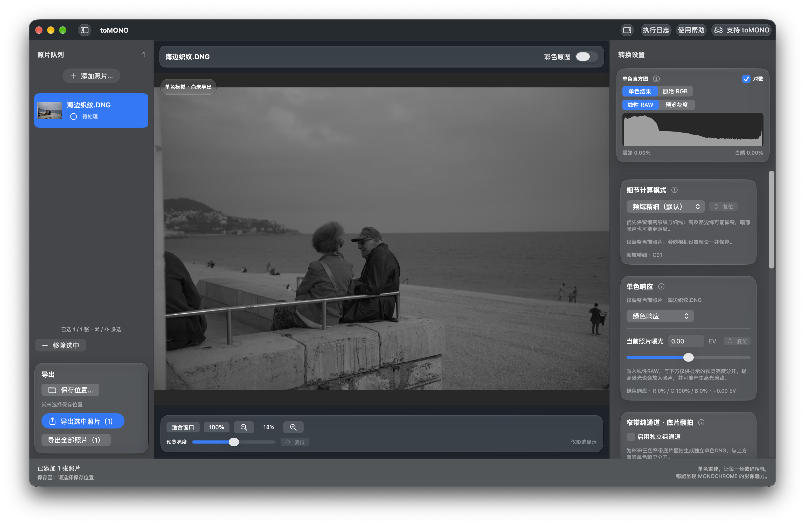
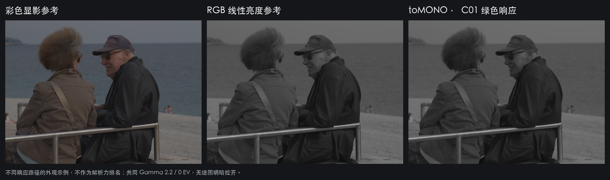
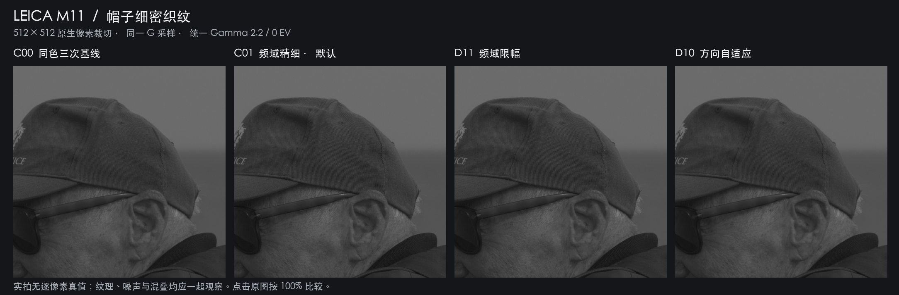
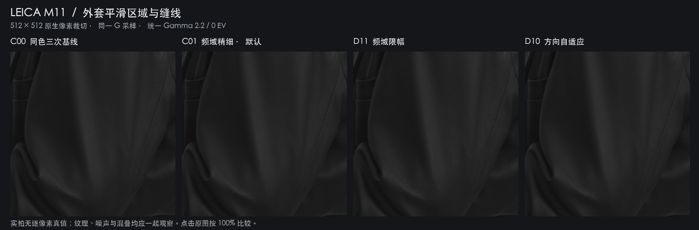

# toMONO

**从 RAW 采样出发，探索单色影像的响应、层次与细节。**

当前版本：**1.1 正式版（1.1.0，构建 15）**。包含D10新默认、LMMSE实验选项、局部检查、预览与导出流程优化，以及GitHub新版检查；下载以对应Release实际提供的安装包为准。

[下载 macOS 版](https://github.com/easonzhangbin/toMONO/releases/tag/v1.1.0) · [图片与比较条件](docs/GALLERY.md) · [使用与构建](docs/BUILD.md)

toMONO 是一个 macOS 原生界面、开放源码的实验性 RAW 单色重建项目。它将彩色传感器的原始采样重建为可继续显影的单通道 DNG，并提供独立 R / G / B 窄带输出，用于底片翻拍等研究。

## 与普通 RGB 照片去饱和度有什么不同？

普通“去饱和度”通常处理的是已经形成的 RGB 图像：先经过彩色重建、白平衡、颜色变换以及可能的色调曲线，再由三个颜色数值计算灰度。具体灰度公式因软件而异；黑白混色器也能改变红、绿、蓝对应的明暗。因此，**普通黑白转换并不都等于简单平均 RGB**。

toMONO 把控制点前移到 **RAW 采样与线性通道响应**：先读取传感器实际测到的数值，按黑电平、白电平和 CFA 排列处理，选择绿色参考、RGB 响应混合或独立窄带通道，估算缺失位置，最后写出单通道线性 RAW。它不对相机内嵌 JPEG 预览做去色；彩色缩略图仅供对照。

“色彩响应”在这里指：**相同曝光下，不同波长的光最终变成多亮的灰色**。红色物体变亮还是变暗，不只由“删除颜色”决定，也取决于光源、物体反射光谱、滤色片响应和通道权重。toMONO 的 RGB 混合在重建后的线性数据上进行，独立窄带模式则只使用所选颜色的真实采样及同色插值。

物理 Monochrom 传感器通常没有 Bayer 彩色滤色阵列，每个感光位置直接积分其自身光谱响应范围内的光。**软件不能移除彩色传感器上的滤色片，不能恢复被滤掉的光，也不能自动得到物理单色传感器的进光量、信噪比或全部空间细节。** 本项目的“Monochrome 模拟”指单色响应与重建方式的探索，尚未标定为某一款实体单色相机的光谱响应。

两条软件路径在特定线性条件、相同通道重建和权重下，也可能产生相同或接近的结果。toMONO 的区别在于处理阶段、采样约束和输出形式；不把它宣传成必然优于所有 RGB 黑白转换。

| 路径 | 输入与处理 | 输出与边界 |
| --- | --- | --- |
| RGB 去饱和 / 黑白混色 | 已形成的 RGB 图像上计算灰度 | 灰度受已有显影与混色设置影响 |
| toMONO RAW 单色重建 | 原始采样 → 通道重建 → 线性响应组合 | 单通道 DNG；仍受原滤色片与采样密度限制 |
| 物理单色传感器 | 无 Bayer 彩色滤色阵列的直接感光 | 属于硬件成像差异，软件不能等效替代 |

进一步阅读：[工作原理](docs/PRINCIPLES.md) · [算法与研究出处](docs/RESEARCH.md) · [构建说明](docs/BUILD.md)。

## 软件界面与响应对照



实际 SwiftUI 工作区，载入实拍 RAW 后生成单色预览；顶部提供“支持 toMONO”入口。



上图展示不同响应路径的明暗关系：中图采用一个明确的线性 sRGB 亮度公式，并不代表所有黑白工具；右图使用 C01 重建绿色响应。两条路径的白平衡与颜色变换不同，这张图用于说明外观差异，不用于证明解析力高低。三栏共同使用 Gamma 2.2、0 EV，没有逐图拉齐明暗。

## 当前功能

- 简体中文 SwiftUI / AppKit 界面、原生材质、缩放与拖动画面、直方图和执行日志；切换模式可显示同一区域的原生像素局部检查。
- 通过 rawpy / LibRaw 识别 RAW；解码能力与本项目的具体重建路径分别检查，不按相机型号白名单锁定。
- 每张照片独立保存响应、曝光和转换设置；可导出选中照片，也可显式导出全部。
- 单通道 DNG、嵌入预览、参数配方与处理记录；拒绝覆盖原图和已有输出。
- 独立窄带 R / G / B 输出，便于在 NegPy 中手动指定三张照片合成。手动选择实际拍摄光源，不做自动窄带识别或亮度拉齐。
- 可选绿色差异校正、明确坐标的坏点修复和 Lensfun 镜头校正。
- Camera Raw 初始外观参数用于接近 toMONO 预览；其他显影器可能忽略这些参数，**不保证跨软件 100% 一致**。
- 启动时在后台检查官方GitHub正式Release；有更高版本时显示改进说明与下载入口。也可从应用菜单“检查更新…”手动检查，下载后自行安装。

## 1.1 的预览与保存改进

默认概览长边为2048像素；首次计算同时缓存线性结果，100%查看按需读取可见区域，复用已生成的结果。双击在点击处放大到100%，再次双击适合窗口。首次概览仍需要RAW解码与完整重建，切换算法或缓存被淘汰后也需要重新计算；导出继续使用完整分辨率与所选算法。

照片队列采用上图下文件名的大缩略图。保存位置可选择“原文件夹 / toMONO”，自动在每张原图目录下建立子文件夹；同名输出自动编号，拒绝覆盖原图。

### 检查更新与联网行为

启动时的版本检查独立于引擎与照片预览，在后台查询本项目的[官方GitHub Releases](https://github.com/easonzhangbin/toMONO/releases)。仅正式稳定Release参与比较；发现更高版本时可查看新版改进说明，选择“稍后”或前往下载。自动检查无更新或遇到断网时不弹出错误；应用菜单“检查更新…”可主动查询并查看状态。

版本检查不上传照片、像素、EXIF、机身编号、照片文件名或本机路径，不需要GitHub登录。GitHub会收到常规网络连接信息，例如IP地址和HTTP请求头。点击下载会由系统浏览器打开官方安装包或Release页面；软件不自动安装，也不在本机单独替换LibRaw等组件。转换、离线帮助和本地日志不依赖版本检查成功。

## 细节计算模式

| 模式 | 标识 | 特点与已知取舍 |
| --- | --- | --- |
| 频域精细 | C01 / `spectral` | 根据同色采样格重建；部分细密织纹表现较好，但可能振铃、放大噪声或改变混叠纹理 |
| 频域限幅 | D11 / `spectral_guard` | 在 C01 基础上限制缺失位的局部范围；可能压制真实极值，仍有相位纹理风险 |
| **方向自适应（默认）** | D10 / `directional` | 绿色采样使用局部方向预测；红蓝使用有界同色三次回退；边缘较保守，但部分周期细纹可能退化 |
| LMMSE 统计重建（实验） | IPOL Zhang–Wu / `lmmse` | 颜色差统计与水平/垂直误差融合；仅用于普通绿色或RGB混合，会借助其他颜色，不适用于独立窄带 |

C01、D11、D10是本项目的确定性研究实现，LMMSE采用另行登记的官方参考实现与接口包装；均不是预训练AI模型，不宣称增加超过采样极限的真实细节。旧预设保留 `legacy` 路径；version 2缺少 `detail_mode` 仍解释为C01，明确保存的选择不会被D10新默认覆盖。

LMMSE仍可能高光过冲，颜色不相关的细纹可能被带入绿色；D10也可能压制真实周期细节，没有一种模式保证所有照片最好。切换模式时可用原生像素“局部检查”放大镜对照同一区域；建议检查点来自反差和纹理启发式，不代表已检测到伪影，也不会自动改动RAW。

LMMSE出处：Lei Zhang、Xiaolin Wu，IEEE TIP 2005，DOI [10.1109/TIP.2005.857260](https://doi.org/10.1109/TIP.2005.857260)；实际参考代码：Pascal Getreuer，IPOL 2011，DOI [10.5201/ipol.2011.g_zwld](https://doi.org/10.5201/ipol.2011.g_zwld)，[v1.1源码](https://www.ipol.im/pub/art/2011/g_zwld/src.tar.gz)。[BSD-2-Clause代码许可原文](portable/src/lmmse/bsd-license.txt)与论文存档文本许可分别保留。官方源码保留，包装负责CFA接口、实测采样恢复、分块和一次最终量化；没有把独立自动混合原型作为原论文最优结论。

详见 [全部技术出处与采用关系](docs/RESEARCH.md) 和 [历史验证边界与复现](docs/VALIDATION.md)。



四栏使用同一张 M11 RAW、同一 G 采样和相同 512×512 裁切。绿色校正、坏点和镜头处理关闭，Gamma 2.2、0 EV，无额外锐化。**点击图片按原生大小观察**；GitHub 缩图可能掩盖差异或产生缩放纹理。实拍没有逐像素真值，清晰观感不能单独证明真实细节增加。

<details>
<summary>同时检查平滑区域、缝线和颗粒</summary>



保留平滑区域作为对照，避免只展示细密织纹。暗部颗粒、相位纹理与边缘过冲同样是选择模式时要考虑的取舍。

</details>

[查看全部原图、生成脚本与比较条件](docs/GALLERY.md)

## 开始使用 / 开发

目标平台：**Apple Silicon、macOS 14 及以上**。构建需要支持源码所用 SwiftUI API 的 Xcode / SDK；macOS 26 的玻璃 API 有运行时可用性检查。最低系统声明不等于所有系统版本均已真机验证。

直接使用请前往 [Releases](https://github.com/easonzhangbin/toMONO/releases/tag/v1.1.0) 下载 `.dmg`，打开后将 toMONO 拖入“应用程序”。本地构建包为 ad-hoc 签名，尚未完成 Apple Developer ID 签名和公证，首次打开可能被 Gatekeeper 阻止。开发者可按下列步骤从源码构建。

```sh
git clone https://github.com/easonzhangbin/toMONO.git
cd toMONO
brew install uv exiftool
./scripts/bootstrap.sh
./scripts/test.sh
portable/.venv/bin/python macos/build_app.py --output .build/toMONO.app
open .build/toMONO.app
```

命令行也可直接使用：

```sh
portable/.venv/bin/python portable/tomono_cli.py input.ARW -o output.dng
```

Xcode、编译模块、DMG 打包和独立窄带示例见 [构建说明](docs/BUILD.md)。Release 提供对应版本 DMG、项目源码、SHA-256 校验文件和第三方源码材料；原始实拍 RAW、历史完整输出、模型权重与训练数据不随仓库发布。

## 研究与贡献

欢迎围绕缺失采样、细节 / 噪声取舍、CFA 相位纹理、线性 RAW 和显影一致性提交可复现的实验。请同时报告成功与失败场景；锐化后的边缘反差不等于新增真实细节。研究来源按“已集成 / 已实验 / 仅参考”区分，见 [研究索引](docs/RESEARCH.md)。

提交问题前请阅读 [贡献说明](CONTRIBUTING.md)。照片、DNG、处理记录和日志可能包含位置、机身编号及本机路径；请先检查再公开上传。

## 请我喝杯咖啡

如果这个实验项目对你有帮助，欢迎支持后续的开发与影像研究。**支持完全自愿，不影响任何功能。**

支付宝扫码，支付前请核对收款方 **StudioPURE**，金额自行决定。

<p align="center">
  
</p>

[支持页面与收款码原图](docs/SUPPORT.md) · 软件顶部也有“☕ 支持 toMONO”入口。

## 许可

项目原创源码按 **GPL-3.0-only** 发布，完整文本见 [LICENSE](LICENSE)。第三方库、数据及其许可独立保留，见 [THIRD_PARTY_NOTICES.md](THIRD_PARTY_NOTICES.md) 和 [来源说明](docs/PROVENANCE.md)。研究论文的引用不表示论文、权重或数据被重新授权或随仓库提供。
