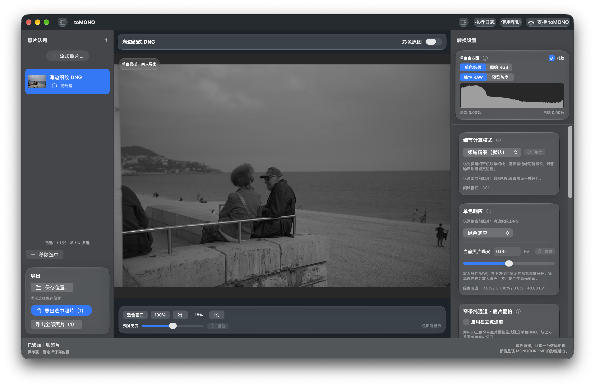
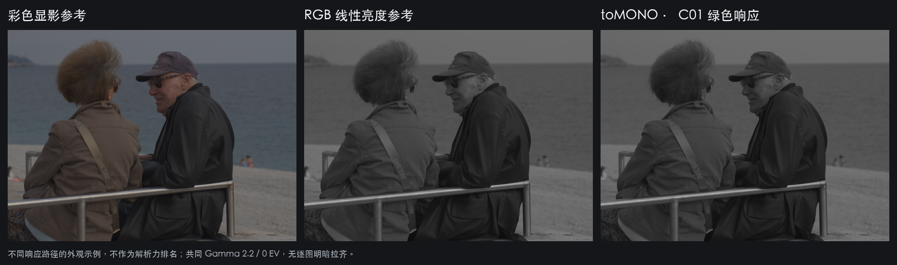
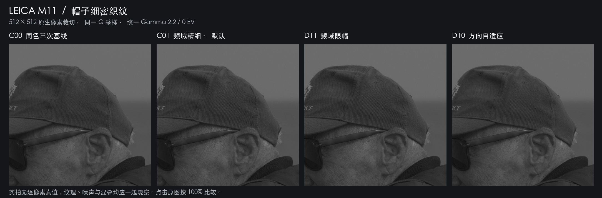
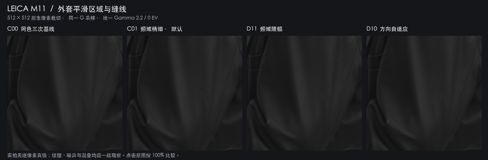

# 软件界面与实拍对比

以下是 Beta 8.1 构建 11 的界面和当前产品重建核实际生成的图像。示例来自项目维护者提供的 M11 实拍，公开的是显示图；原始 RAW 和拍摄元数据不随仓库公开。

## 主界面



当前产品 `ContentView` 与完整转换后台在独立截图窗口中运行，真实载入 RAW，待预览与直方图计算完成后截图。只对拍摄文件的本地副本移除序列号、GPS 和作者字段，源文件保持不变；没有拼接、重绘界面或生成图像内容。设置为 C01、绿色响应、0 EV、预览亮度 0，绿色差异校正关闭。

## 响应路径的外观



| 栏目 | 实际处理 |
| --- | --- |
| 彩色显影参考 | LibRaw、相机白平衡、线性 sRGB、不自动提亮 |
| RGB 线性亮度参考 | 对上一栏线性 RGB 计算 `0.2126R + 0.7152G + 0.0722B`，再编码显示 |
| toMONO C01 | 从原始 G 位置重建，使用传感器黑白电平归一化，无白平衡、颜色矩阵或额外校正 |

共同条件：0 EV，在线性域面积平均缩小至 750×550 后使用 Gamma 2.2。两条响应路径本来不同，未人为归一化到相同中灰；这不是算法解析力排名，也不是 ACR 默认显影对比。RGB 亮度公式只是一个可复现的黑白转换例子，不概括其他软件的全部黑白选项。

## 算法对照：织纹与平滑区域





- 四栏依次为 C00 同色有界三次基线、C01 频域精细、D11 频域限幅、D10 方向自适应；C00 为严格同色研究基线，不是普通旧绿色模式包含校正后的总效果。
- 统一从当前代码计算，每个 ROI 取原生 512×512 像素；计算时外扩 64 像素，再去掉外扩区域，超过当前核的 48 像素最大半径。
- 只用同一组 G 测量，黑电平 1023、白电平 16383；一次最终 DN 量化，Gamma 2.2、0 EV，无逐图拉伸或额外锐化。没有绿色差异校正、坏点修复或镜头校正。
- 这些实拍没有逐像素真值；织纹清晰、混叠、颗粒、振铃和相位纹理需一起观察。不能仅凭一个局部认定某方法在所有相机、场景或 ISO 下更好。
- 点击图片并按 100% 原生大小比较，浏览器缩放可能引入新的纹理。图片内嵌相同显示 ICC；不承诺所有图片查看器一致执行色彩管理。

生成脚本：[generate_readme_figures.py](../scripts/generate_readme_figures.py)。[来源摘要、ROI 和各结果摘要](images/comparison-provenance.json)记录计算条件，不包含本机路径。脚本需要本地持有指定样片，不能仅凭这些 PNG 重新生成 RAW。

```sh
portable/.venv/bin/python scripts/generate_readme_figures.py /path/to/L1008601.DNG --work /tmp/tomono-gallery
```

本页只增加展示资料，不修改应用算法或现有 DNG 文件。源代码与展示图的权利范围分别参见 [NOTICE](../NOTICE)。
